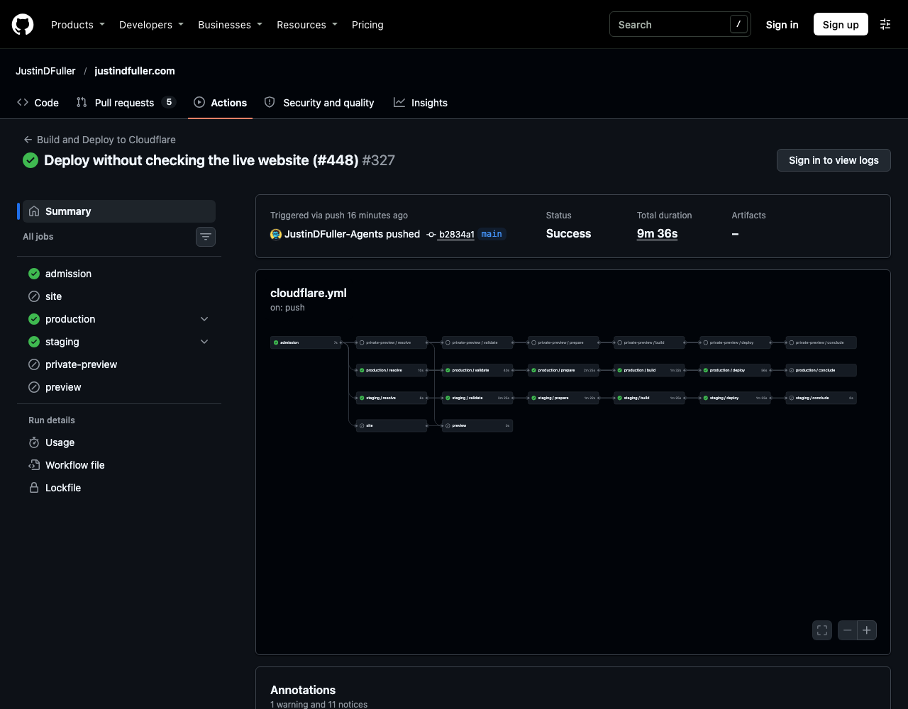
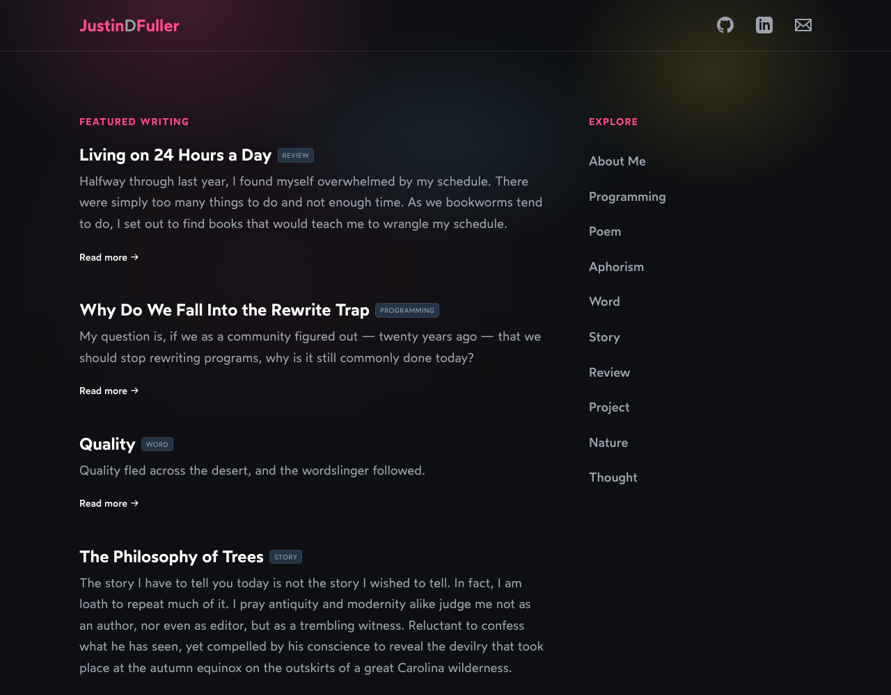

# QA

## Result

With Bot Fight Mode on, the release run on the default branch deployed production and staging and finished green, without making any request to the published website.

## Run

- Run: 41238070011, event `push`, commit `b2834a1b96b2e2d7df2955cb2673d7432ddda281`, started 2026-10-31 20:15:44Z, completed `success` at 20:25:20Z.
- Jobs: `admission`, `production` and `staging` succeeded (resolve, validate, prepare, build, deploy). `site`, `private-preview`, `preview` and both `conclude` jobs were skipped.

## Bot Fight Mode

The Cloudflare API (`bot_management`) reported `fight_mode: true` at 2026-10-31 20:21:42Z, before either deploy, and again at 20:25:47Z, after both. It was turned on in the dashboard by the owner.

## Cloudflare deployments

| Worker                       | Version                                                       | Deployment | Time (UTC) | Traffic | Version message prefix |
| ---------------------------- | ------------------------------------------------------------- | ---------- | ---------- | ------- | ---------------------- |
| `justindfuller-site`         | #47 `0b9ff2a0` (was #46 `b65de770`)                           | `2adc4118` | 20:25:08Z  | 100%    | `bbd0d06dcf65`         |
| `justindfuller-site-staging` | #47 `346ae6dd` (was #46 `ff0874e2`, which never took traffic) | `b2ab9b31` | 20:23:42Z  | 100%    | `778022751ecd`         |

Staging had been stuck on `79d21ccc` since 2026-10-22 and is now serving the new version, which confirms the API lookup replaced the unreadable CLI output.

## Live site

The public site rendered after the release.

## Failed attempts before this change

Runs 41065490632, 41056076145, 41052760823, 41052556978, 40979854239 and 40799220072 on the default branch failed. 41065490632 (Bot Fight Mode off) deployed production and failed while staging read the uploaded version from CLI output.

## Not proven

- The full 64-character version message was not compared with the run's artifact checksum by hand. Only the 12-character prefixes were read. The deploy step itself checks equality.
- This was a `push` run, not a manual `content` run, and `conclude` was skipped, so the behavior of `conclude` with a rejected note was not exercised.
- The Cloudflare dashboard and the Access-protected staging site were not captured. The dashboard needs the owner's login and was verified through the API instead.
- A failed Cloudflare deploy and the rollback through the API were covered by unit tests only, not by a real failing deploy.
