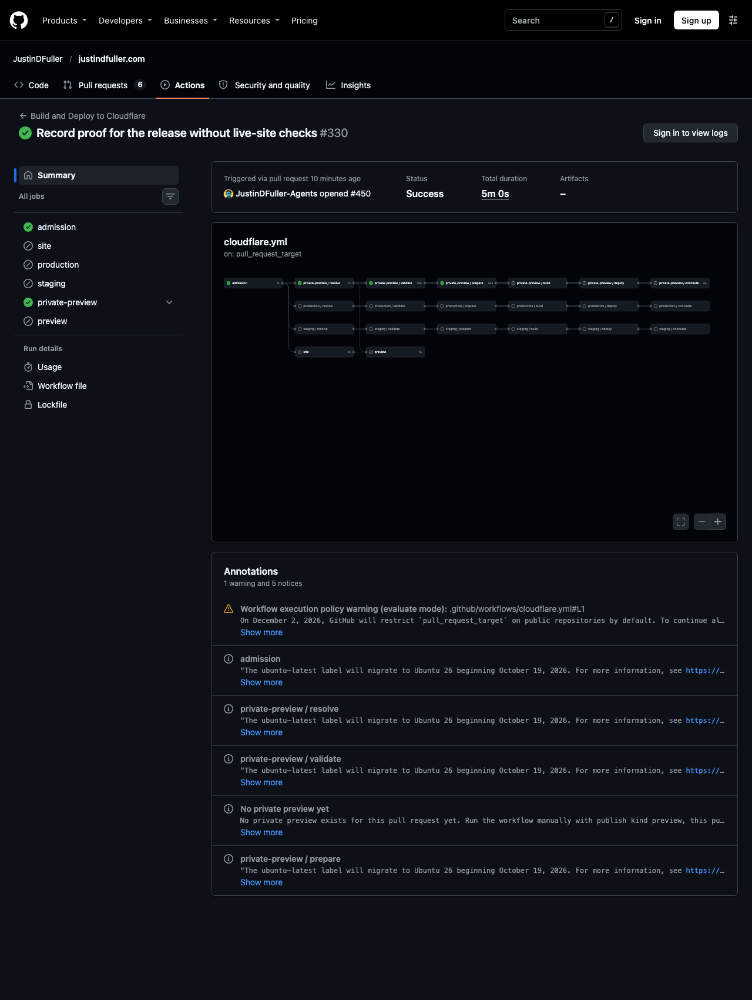

# QA

## Result

A pull request with no preview yet now gets a green, neutral `private-preview / prepare` check with a notice, and build, deploy and conclude are skipped.

## Run

- Pull request: #450 (docs only), event `pull_request_target`, run 41239401960, workflow taken from `main` at `ab44252d7c934a3c49e603357c34ff7e9f919479` (the merge of this change), completed `success`.
- `private-preview / resolve`, `validate` and `prepare` passed. `build`, `deploy` and `conclude` were skipped.
- The `prepare` job (job 124650908891, 54s) carried this notice annotation titled "No private preview yet": "No private preview exists for this pull request yet. Run the workflow manually with publish kind preview, this pull request number and bootstrap to create one." It contains no storage names, paths, revisions or note identifiers.

## Before

On every pull request that reached the private preview job (13 of the last 25 runs back to 2026-10-16), `prepare` failed with `accepted_state_unavailable` and build and deploy were skipped. #449's own check failed the same way before merge, because pull request events run the workflow from `main`, which did not yet contain this change.

## Not proven

- A manual preview refresh with no state still fails with `accepted_state_unavailable`, and production and staging still fail without state. This is covered by unit tests (254 tests, 251 passing, 3 Linux-only container tests skipped on macOS) and was not exercised in a real run, because it would create a deliberately failing run.
- A pull request that already has a preview refreshing as before was not exercised, because none exists.
- An unreadable state store was not simulated against the real store.

## Seen while checking

The run page shows a workflow execution policy warning: on 2026-12-02 GitHub will restrict `pull_request_target` on public repositories by default, and the workflow will need to opt in. This is unrelated to this change and is not addressed here.
